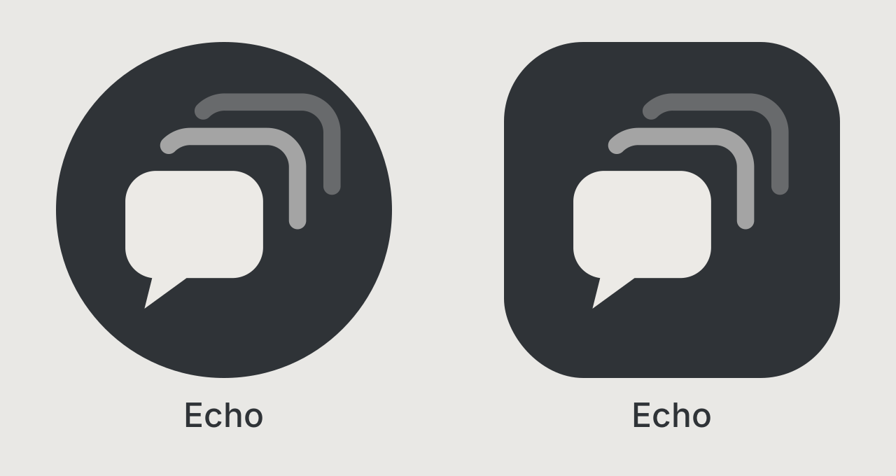

# Echo

**Torn chat notifications on Android, plus your userscripts.**

Since Chat 3.1, Torn PDA hasn't been able to send chat notifications. Echo is a stop gap until it can: Torn in an app that keeps listening while it's in the background. When someone posts in your faction or company chat, or sends you a message, you get a notification with who said what, on your phone and your smartwatch. It also runs your Greasy Fork / Tampermonkey and Torn PDA userscripts.

Echo is in testing. It works well on the phones it's been tried on so far, and reports from other phones are very welcome (see [Problems?](#problems)).

## Install

Android 8 or newer.

1. On your phone, open the [latest release](../../releases/latest) and download `echo.apk`.
2. Open it. Android asks you to allow installs from your browser: allow it, then tap **Install**.
3. Open **Echo** and log in to Torn as normal.
4. Allow notifications, then let Echo run without battery restrictions when it asks.
5. **Samsung:** Settings → Battery → Background usage limits → **Never sleeping apps** → add Echo. Other brands with strict battery savers (Xiaomi, OnePlus, Huawei…) need a similar setting.
6. Open the chats you want to hear about (faction chat, for example). Then leave Echo whenever you like.

A quiet "Watching Torn chat" notification stays in your notification shade. That's what lets Echo keep running; tap **Stop** on it to turn Echo off.

Echo updates itself from this page. The first time, Android asks you to allow Echo to install updates; after that they install in the background.

## Features

- **Chat notifications** for faction, company and private messages, grouped as conversations with each sender's name. Choose which chats notify you in Settings (Global and Trade are off by default).
- **Keeps working in the background**, even with the screen off.
- **Looks after itself:** if the chat connection drops, the page stops responding, or your phone switches between Wi-Fi and mobile data, Echo reloads Torn in the background so notifications keep coming.
- **Userscripts:** Menu → Scripts → Add script. Paste a Greasy Fork link, paste the code, or share a Greasy Fork page to Echo. Tampermonkey-style (`GM_*`) and Torn PDA-style scripts both work, including `###PDA-APIKEY###` with a key you set in Settings.
- **Updates itself**, and starts again after your phone restarts.

## Privacy

- You log in on torn.com itself. Echo never sees your password and only uses an API key if you give it one for your scripts.
- Echo reads the chat events Torn's own page already receives. It doesn't send anything, click anything or automate anything. The only things it does by itself are loading and reloading Torn.
- Nothing leaves your phone except Torn's own traffic, update checks to this page, and requests your scripts make.
- Diagnostics and problem reports stay on your phone until you choose to share them. They never include message text, but they do include the names of people who sent messages.

## Limits

- Android only. iOS doesn't let apps stay connected in the background.
- Staying connected uses some battery, similar to a chat app.
- Torn only sends live messages for chats that are open in your chat bar.
- If you log out of Torn in Echo, notifications stop until you log in again.

## Problems?

- **Faction or company chat missing** (Echo says "Watching private messages" and Torn's chat bar has no faction or company tab): log out of Torn in Echo and back in. Echo tells you when this happens.
- **Something else not right:** try Menu → Reload, then Menu → Reset Torn chat (you stay logged in).

To report a problem, open Echo → Settings → **Problem reports** (saved automatically when chat goes wrong) or **Diagnostics**, tap **Copy**, and send it by Torn mail to [Nyxii [3829839]](https://www.torn.com/profiles.php?XID=3829839). Please don't post reports publicly: they include the names of people in your chats.
